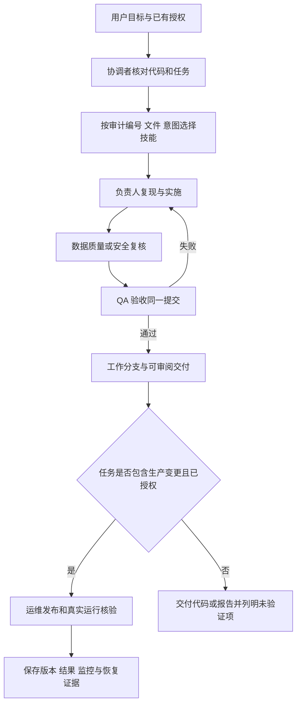

# 维度足球智能体角色与工作流

这套配置把 [2026-10-30 项目审计](https://chatgpt.com/space/page_ed7380a0df008191bfcc39c3931b63d0) 转为编码助手可使用的角色、技能、责任分工和验收门槛。审计基线是 `2fb4007e4c92ca26ac2d538c1714b136a68f9e83`；后续任务必须复核当前版本，不能把历史发现直接写成今天的运行状态。

## 如何自动调用

将本分支检出到支持仓库指令的编码助手工作区。助手读取根 `AGENTS.md` 后，按任务选择 `.agents/skills/` 中的 `SKILL.md`。支持项目技能发现的宿主也可以直接识别这些技能；支持 `$技能名` 的客户端可显式调用，例如 `$vantis-reliability`。不同客户端的 UI 和加载行为以该宿主为准。

路由命令使用本地 Node.js，无依赖、无 API Key：

```sh
npm run agents:check
npm run agents:route -- --finding A01
npm run agents:route -- --finding A04 --finding A05
npm run agents:route -- --file scripts/package.py
npm run agents:route -- --task '检查每小时生产调度与服务器状态'
npm run agents:route -- --role collector --task '接入第二独立亚洲盘来源'
```

直接消费纯 JSON 时使用 `node scripts/agent-workflow.mjs route --finding A01`，避免 npm 的命令标题混入标准输出。路由优先使用显式角色、审计编号和文件归属；都没有匹配才使用自然语言提示。文件按最长前缀匹配，例如 `collector/sources/test/` 属于 QA，`collector/sources/full-analysis.mjs` 的特定归属优先于 sources 目录。

输出中的 `coordinator` 负责确认意图，`owners` 负责实现，`reviewers` 负责后续复核，每个对象都给出实际技能路径。`needsClarification=true` 表示规则未分类，应由协调者先定位任务，不代表必须立刻打断用户询问。

**自动调用发生在编码助手会话内。** 这些文件不注册云端常驻智能体、不调用 Agents API/SDK、不安装 MCP 插件，不创建新的每小时采集计划。路由命令只给选择结果；执行宿主按 AGENTS.md 读取技能并完成任务。当前配置没有引入模型费用。

## 角色及职责

| ID | 角色 | 主要产物 | 后续复核 |
| --- | --- | --- | --- |
| orchestrator | 项目协调 | 任务卡、依赖与写入范围、交付状态 | QA |
| collector | 数据采集 | 来源适配器、契约、配额及来源证据 | 数据质量、安全、QA |
| data-quality | 数据质量 | 身份、时效、缺页与缺项状态 | QA；按问题增加研究或采集 |
| research | 预测研究 | 策略解释、概率语义、回测方案与指标 | 数据质量、QA |
| reliability | 运行可靠性 | 生命周期、退出状态、锁、检查点及原子报告 | QA、运维 |
| security | 安全交付 | 源码包边界、敏感文件保护、权限审查 | QA |
| qa | 测试验收 | 当前提交的复现与回归证据、验收判定 | 协调者汇总 |
| operations | 生产运维 | 实际版本、唯一调度责任、真实运行及恢复记录 | 安全、QA |

每个角色的完整提示词、工作步骤、输入和验收位于根 AGENTS.md 链接的独立 SKILL.md。角色表是逻辑分工，并不意味着每轮启动 8 个模型。

## 工作流



允许并行时，A02 的打包修复可以与可靠性任务独立实施。A01 和 A03 共享 `run.mjs`，由同一负责人统一实现；A04 和 A05 共享 `full-report.mjs`，也由同一负责人处理。数据来源适配器与其消费者契约存在依赖，应先确定接口再并行。

审查角色在实现之后复核，不能同时改写执行者文件。多个角色涉及同一文件时先确定唯一写入者；配置中的路径归属是默认路由，并非文件权限系统或禁止合理跨文件修改的规则。

## 可直接使用的总协调提示词

```text
在 wangxtong/Dimension-Football- 工作。
读取 AGENTS.md、config/agent-workflow.json 和相关 SKILL.md。
任务：{用户目标}
范围：{审计编号或文件，可留空由你定位}
沿用本会话已有授权，先核对当前版本与未提交改动。
按路由选择负责人及复核角色，把任务推进到可审阅、可验证的交付。
支持且允许子智能体时，仅并行委派写入范围独立的任务；否则顺序执行角色。
不得用历史审计、演示成功或 CI 通过替代当前生产证据。
输出修改、实际验证、未验证范围与交付链接。
```

委派给具体角色时使用以下任务卡；把真实值填入，不留下占位符就启动工作：

```text
角色与技能：{role ID，SKILL.md 路径}
目标：{用户要求}
基线：{分支/提交}
问题：{A01 等或新问题；事实与假设分开}
输入：{源码、合成样本、允许使用的真实数据及证据路径}
写入范围：{独占文件；共享文件的唯一负责人}
依赖：{上游契约或前置任务}
验收：{可观察的目标行为与应运行的检查}
授权范围：{继承用户会话，不扩大权限}
交接：{变更、验证命令、结果、未验证项、复核者}
```

## 技能自动选择示例

| 用户任务 | 负责人技能 | 关键验收 |
| --- | --- | --- |
| 修复 A01 深度失败仍成功退出 | vantis-reliability | 全失败和取消非零，正常缺项语义明确 |
| 修复 A02 ZIP 含环境文件 | vantis-security | 嵌套 `.env.*` 不入包，合法源码完整 |
| 修复 A04 和 A05 | vantis-data-quality | 旧材料与缺页传播至逐场结论 |
| 接入第二独立盘口来源 | vantis-collector | 来源独立、同场同盘、双边报价及时间可核验 |
| 检查预测准确率 | vantis-research | 有时间隔离的真实评估样本；没有则标未验证 |
| 检查服务器是否每小时采集 | vantis-operations | 当前部署提交、定时器、真实报告及源时间 |
| 对修复做回归验收 | vantis-qa | 同一提交下复现、期望、实际、证据完整 |

表格是示例；自然语言存在歧义时由协调者判断，不保证字符串匹配穷尽所有表达。

## 按需使用外部技能

| 实际任务 | 可用时加载的技能 | 加载条件 |
| --- | --- | --- |
| 托管云环境、网络与身份诊断 | cloud-environment:cloud-environment-runtime | 当前执行环境确实受其管理 |
| 新增 Agents API/SDK 应用 | openai-developers:agents | 用户任务实际要求构建模型驱动的应用 |
| 配置或运行 OpenAI 服务 | openai-developers:openai-platform-api-key | 遵守其凭据配置流程，不在文档中索取明文 Key |
| 已发生的 OpenAI API 错误 | openai-developers:openai-api-troubleshooting | 先有真实错误，再分类处理 |
| 缺少任务必需的外部连接能力 | plugin-management:plugin-management | 先搜索可用工具，按工具规定连接，不声称已安装 |

这些是宿主侧技能名称引用，不是项目依赖。本次新增的 8 个本地技能无需这些外部插件即可阅读和路由。以后若真正建立常驻多智能体服务，需要单独实现执行器、会话、身份、预算、调度、日志和故障恢复。

## 验收与维护

- `npm run agents:check` 验证角色 ID、技能文件和 frontmatter、复核引用、A01–A05 覆盖与审计基线。
- 路由用例至少覆盖 A01、A02、A04/A05、特定文件、自然语言、未知任务与非法参数；配置文件校验不证明宿主实际完成技能自动加载。
- CI 在原测试前执行 `agents:check`；运行时业务代码保持独立，原有 `npm test` 和 demo 仍负责业务回归。
- 审计状态以 `config/agent-workflow.json` 为机器来源；修改状态时同步待办文档并附当前提交证据。没有修复实证不能从 open 改成 verified。
- 此技能目录随 Git 仓库交付。现有生产源码 ZIP 打包脚本不包含根 AGENTS.md 和 `.agents/`，使用技能时检出 Git 分支；生产运行不依赖这些技能文件。

交付时至少报告：代码检查、离线用例、公开源网络、正式 API、生产运行分别哪些已通过、失败或未验证。角色配置完成不表示 A01–A05 已修复。
