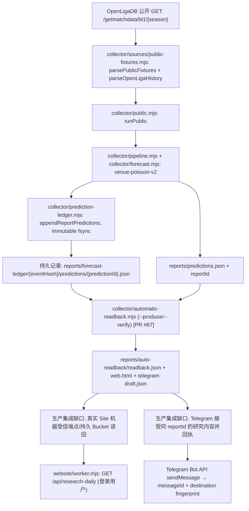

# 维度足球：非商业研究预测交付契约与可追溯数据流

**用户验收口径（2026-11-02）：** 凡未取得正式 Web **真实登录后读回**和 Telegram **同 reportId 的 API accepted 消息 ID**，均不得写「已上线」「已推送」。版本控制中的契约可通过 Git 历史追责，但软件/外部服务无法保证「不可撤销」或「永不掉线」；每个实际失败必须可见并触发 FAIL，不补造。

## 实际生产/研究流水线（以仓库 main/部署版本精确 SHA 验证）

**事实与边界：** A→I 已在 PR #67 精确 SHA `209a759a5bcc8b52fd083b9a9869c298ce9c7c6a` 的原生 Actions #41418161223 真实源隔离跑通，9场自动冻结、9场哈希读回，未来36小时0场。研究端点实际源是另一种 `research-daily-1x2` schema，只包含当天合格研究输出；该文件与 I 尚无**精确同格式**上线桥接。J、L 缺真实成功回执，不得把箭头或自动生成的 HTML/TG 草稿当作已部署或已发送。

**存储模型**：现行项目并没有关系型「数据库表」可列示。不可变文件目录是事实上的预测账本，云端持久存储是 `BUCKET` 中的 `research-daily/reports/{reportId}.json` + `research-daily/current.json`；不得谎称 D1/PostgreSQL 表已存在。所有路径必须使用原生 source/team/fixture IDs、UTC kickoff、原始响应时间及 sha256，不允许手动补造行或根据别家球队名称猜测同一赛事。

**Web 验收**：在原已配置的正式域名 `https://dimension-football-live-wangxtong.secretmelon37.chatgpt.site`，授权登录后 GET `/api/research-daily`，返回 exact `reportId`、预测比赛ID和三向概率，写入后的独立读取必须同时证明主仓代码 SHA/部署 SHA/服务器独立开关已启用、来源展示权益已批准。未读回=FAIL。

**TG 验收**：只允许当前已批准的 Bot、频道ID与源字段权限，不能复用已经拒绝的商业预测出口。发送后持久保存 `reportId`、`payloadSha256`、`chatIdFingerprint`、`messageId`、`sentAt`，并在真正回复中检查 target chat ID；无 messageId、UNKNOWN、超时一律不报告发送成功、不自动盲重试。不要把曾经发送的「数据状态日报」冒充预测消息。

## 每日系统心跳合同（北京时间）

每日定时由持久运行器自动执行：同一调度周期对本日实际源调用逐条记录 **成功/失败数量和分母**，模型训练成功的完整 UTC 时间戳、当日新冻结预测条数、已验证运行器身份/健康状况（只能是 Healthy / Unhealthy）。时间基于真实 UTC 时钟，不以训练/网络缓存冒充新数据。对于任何字段缺失，报告 `Unhealthy` 和缺失原因，禁止用0取代未知。数据内容不得包括密钥、原始受限赔率。

验收前提：Site 实际可用的 Bot 出站接口 + Bot Token/频道目标均为受控运行环境配置；GitHub Actions 的独立机器环境**不能**自动读取 Site 的秘密。每天 Telegram Bot API accepted 的消息ID必须被单独持久读回；`NOT_SENT`、`UNKNOWN`、`AUTH_BLOCKED`、`DELAYED`、`MANUAL_BACKFILL`或当天缺消息一律系统 `Unhealthy`，即使普通 CI 是 green 也不得升格。

**预期任务归属：** A2/A3 真实来源、原始归档/存储；A4 自动模型/FT；A6 Web+TG 投递与回执；A7 现场调度、心跳与健康；A8 安全、逐字段权益；A10 同 SHA 独立验收；A1 统一阻断裁决。

**当前真实状态（非承诺）：** Web 自动预测9场正式上线尚未验证；TG 预测出站未发送（无 messageId）；每日含四字段心跳未建立投递链。以上缺项均为 **FAIL / NOT_VERIFIED**，未通过用户交付契约。
